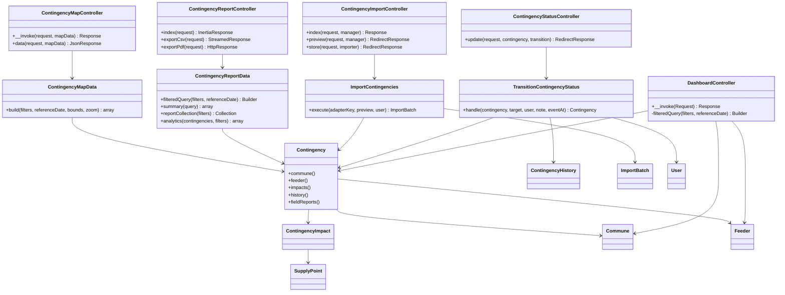
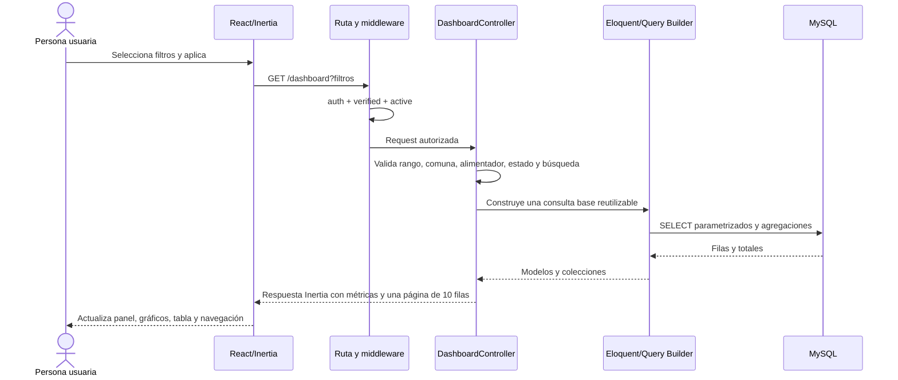
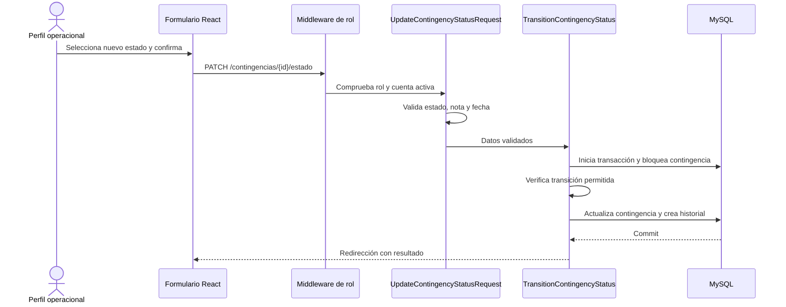
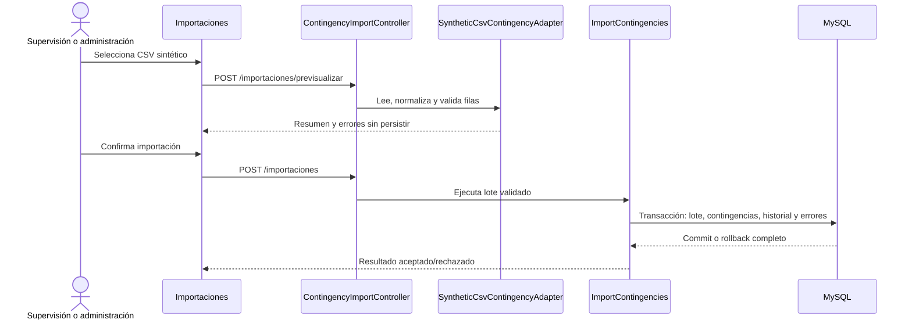
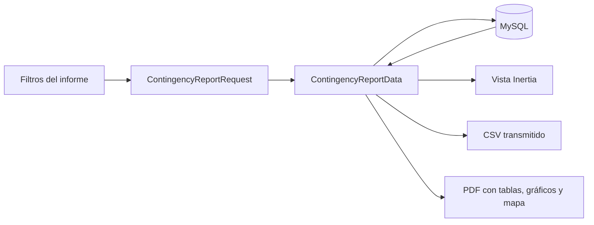

# Arquitectura, clases y recorrido de datos

Este documento explica el recorrido técnico de SIGCEL desde la interacción de
la persona usuaria hasta MySQL y de regreso a la interfaz. Complementa el
modelo entidad-relación de `ARQUITECTURA_MODELO_ACTUAL.md`; no reemplaza el
código ni presenta componentes que no estén implementados.

## Responsabilidades por capa

| Capa | Ubicación | Responsabilidad |
| --- | --- | --- |
| Interfaz | `resources/js/Pages` y `resources/js/Components` | Formularios, filtros, tablas, gráficos y navegación con React e Inertia. |
| Entrada HTTP | `routes/web.php` y `routes/auth.php` | Relacionar URL y método HTTP con middleware y controlador. |
| Seguridad | middleware y `app/Http/Requests` | Autenticar, verificar cuenta activa, autorizar por rol y validar entradas. |
| Aplicación | `app/Http/Controllers` | Coordinar la solicitud y preparar la respuesta Inertia, JSON, CSV o PDF. |
| Dominio | `app/Services`, `app/Support` y `app/Enums` | Transacciones, estados, importación, mapas, informes y reglas reutilizables. |
| Persistencia | `app/Models` y `database/migrations` | Consultas Eloquent, relaciones, restricciones e índices de MySQL. |
| Presentación final | Inertia y React | Recibir propiedades serializadas y actualizar la vista sin duplicar reglas de seguridad. |

La interfaz puede ocultar acciones por usabilidad, pero el permiso efectivo se
comprueba nuevamente en Laravel. Las consultas variables se construyen con
Eloquent o Query Builder, que enlazan los parámetros; no se concatena SQL
recibido desde formularios.

## Diagrama de clases principales

## Secuencia de consulta del dashboard

Todos los indicadores parten de la misma consulta filtrada. La distribución
por comuna y por estado usa agregaciones; la tabla pagina todos los resultados
en grupos de diez y conserva los filtros al navegar. La búsqueda e informes
cubren consultas especializadas y exportaciones.

## Secuencia de cambio de estado

La secuencia válida es `reported` → `assigned` → `in_progress` → `restored`
→ `closed`. El servicio usa transacción y bloqueo para evitar actualizaciones
simultáneas incoherentes.

## Secuencia de importación

## Flujo de informes

## Cómo modificar una función sin romper el recorrido

1. Identificar la página React y la ruta que recibe la acción.
2. Revisar middleware y rol antes de cambiar la visibilidad del control.
3. Ajustar o crear un `FormRequest` para validar la entrada en el servidor.
4. Mantener el controlador como coordinador; ubicar reglas transaccionales o
   reutilizables en un servicio.
5. Modificar modelos o migraciones solo si cambia la persistencia.
6. Agregar o actualizar la prueba de característica correspondiente.
7. Ejecutar `php artisan test` y `npm run build` antes de desplegar.
8. Verificar staging con `verify.sh` y `operational-check.sh`.
