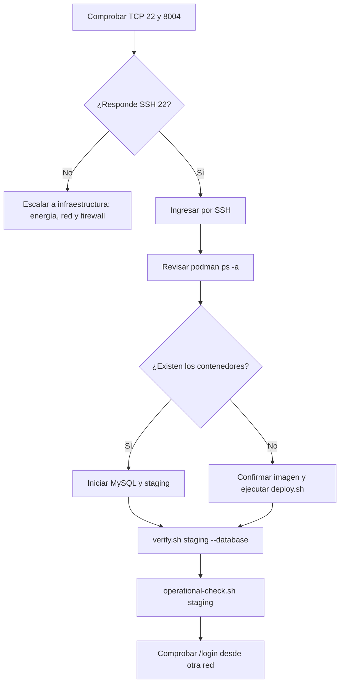

# Incidente de disponibilidad de Parra — 28 de octubre de 2026

## Observación

El nombre `parra.chillan.ubiobio.cl` resolvió a `146.83.196.166`, pero desde la
red de comprobación no fue posible establecer conexión TCP con los puertos 22,
80, 443, 8003 ni 8004. La ausencia simultánea de SSH y del puerto de staging
impide atribuir el incidente únicamente al contenedor SIGCEL.

Este resultado demuestra falta de accesibilidad desde el punto de prueba; por
sí solo no distingue entre servidor apagado, interfaz de red, enrutamiento,
firewall o restricción institucional.

## Árbol de recuperación



## Comandos después de recuperar SSH

```bash
podman ps -a --format 'table {{.Names}}\t{{.Status}}\t{{.Ports}}'
podman start luzparral-mysql
podman start luzparral-staging

~/luzparral/scripts/verify.sh staging --database
~/luzparral/scripts/operational-check.sh staging
```

Si el contenedor de aplicación no existe, se debe confirmar primero la imagen
disponible con `podman images luzparral-app`. La última imagen previamente
verificada fue `luzparral-app:cb42de79d5de`; antes de reutilizarla se debe
comparar con el commit vigente.

```bash
~/luzparral/scripts/deploy.sh \
  staging \
  luzparral-app:cb42de79d5de \
  ~/luzparral/config/parra-staging.env \
  ~/luzparral/config/mysql.env
```

## Recuperación comprobada — 29 de octubre de 2026

La conexión SSH volvió a estar disponible y se iniciaron explícitamente los
contenedores `luzparral-mysql` y `luzparral-staging`. Después de esperar su
arranque se obtuvo la siguiente evidencia:

- aplicación disponible y contenedor `running / healthy`;
- puerto de staging `8004 -> 8080`;
- MySQL accesible únicamente por la red privada, sin publicar `3306`;
- comprobaciones de aplicación, base de datos y esquema en estado `ok`;
- `verify.sh staging --database` aprobado;
- `operational-check.sh staging` aprobado;
- respaldo verificado con tres días de antigüedad y uso de disco del 5 %.

La recuperación confirma que la aplicación y sus datos estaban íntegros. La
interrupción inmediata se resolvió iniciando los contenedores; queda pendiente
determinar por qué no se levantaron automáticamente. El acceso de revisión se
realiza mediante túnel SSH cuando la red externa no permite conectar
directamente con el puerto 8004.

## Criterios de cierre

El incidente solo se considera cerrado cuando existe evidencia de:

1. conexión SSH recuperada;
2. contenedores `luzparral-mysql` y `luzparral-staging` en ejecución;
3. salud `healthy` del contenedor de aplicación;
4. `verify.sh staging --database` aprobado;
5. `operational-check.sh staging` aprobado;
6. acceso real a `http://parra.chillan.ubiobio.cl:8004/login` desde una red de
   usuario.

No se deben reconstruir volúmenes ni ejecutar seeders para resolver un
problema de conectividad. El respaldo previo al despliegue y los datos
persistentes se preservan hasta determinar la causa.
